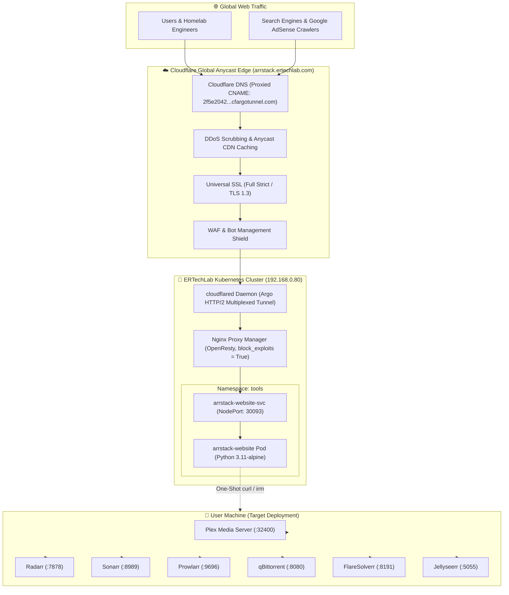

# ⚡ ARRSTACK // One-Shot Media Suite Automation

```text
  ██████╗ ██████╗ ██████╗ ███████╗████████╗ █████╗  ██████╗██╗  ██╗
 ██╔══██╗██╔══██╗██╔══██╗██╔════╝╚══██╔══╝██╔══██╗██╔════╝██║ ██╔╝
 ███████║██████╔╝██████╔╝███████╗   ██║   ███████║██║     █████╔╝ 
 ██╔══██║██╔══██╗██╔══██╗╚════██║   ██║   ██╔══██║██║     ██╔═██╗ 
 ██║  ██║██║  ██║██║  ██║███████║   ██║   ██║  ██║╚██████╗██║  ██╗
 ╚═╝  ╚═╝╚═╝  ╚═╝╚═╝  ╚═╝╚══════╝   ╚═╝   ╚═╝  ╚═╝ ╚═════╝╚═╝  ╚═╝
```

> **[OFFICIAL PRODUCTION REPOSITORY]**  
> *The ultimate automated media deployment framework. One-shot cross-platform installer for Plex Media Server, Sonarr, Radarr, Prowlarr, qBittorrent, FlareSolverr, and Jellyseerr.*  
> Engineered by **Efrain Rivas** — Senior Enterprise Infrastructure Architect.  
> Production Portal: **[arrstack.ertechlab.com](https://arrstack.ertechlab.com)**

---

## ⚡ Live Telemetry & Badges

[](https://arrstack.ertechlab.com)
[](https://arrstack.ertechlab.com)
[](https://dash.cloudflare.com)
[-326ce5?style=for-the-badge&logo=kubernetes&logoColor=white)](https://k3s.io)
[](https://arrstack.ertechlab.com)
[](https://arrstack.ertechlab.com/ads.txt)
[](https://arrstack.ertechlab.com)

---

## 🚀 Instant Deployment (One-Liner)

### 1. Linux & macOS (Universal Bash)
```bash
curl -fsSL https://arrstack.ertechlab.com/install.sh | bash
```

*Options:*
```bash
# Non-interactive silent installation
curl -fsSL https://arrstack.ertechlab.com/install.sh | bash -s -- --silent

# Custom storage directory (default: /data)
curl -fsSL https://arrstack.ertechlab.com/install.sh | bash -s -- --storage /mnt/storage

# Direct native host OS packages (Debian/Ubuntu/macOS)
curl -fsSL https://arrstack.ertechlab.com/install.sh | bash -s -- --native
```

### 2. Windows 10 / 11 / Server (PowerShell)
Open PowerShell as Administrator and run:
```powershell
irm https://arrstack.ertechlab.com/install.ps1 | iex
```

### 3. Docker Compose (Direct Manifest)
```bash
curl -fsSL https://arrstack.ertechlab.com/docker-compose.yml -o docker-compose.yml && docker compose up -d
```

### 4. Standalone Windows Desktop Installers
- **Graphical Wizard**: [ArrStack-Installer.exe](https://arrstack.ertechlab.com/downloads/ArrStack-Installer.exe)
- **Enterprise Package**: [ArrStack-Setup.msi](https://arrstack.ertechlab.com/downloads/ArrStack-Setup.msi)

---

## 🧭 Ecosystem & Default Port Topology

| Service | Port | Default URL | Purpose |
| :--- | :--- | :--- | :--- |
| **Plex Media Server** | `32400` | [http://localhost:32400/web](http://localhost:32400/web) | Universal 4K HDR media streaming and hardware transcoding |
| **Radarr** | `7878` | [http://localhost:7878](http://localhost:7878) | Automated movie monitoring, quality profile upgrades & naming |
| **Sonarr** | `8989` | [http://localhost:8989](http://localhost:8989) | Automated TV series episode tracking and season renaming |
| **Prowlarr** | `9696` | [http://localhost:9696](http://localhost:9696) | Centralized BitTorrent & Usenet indexer proxy synchronizer |
| **qBittorrent** | `8080` | [http://localhost:8080](http://localhost:8080) | Headless BitTorrent download daemon (Default User: `admin` / `adminadmin`) |
| **FlareSolverr** | `8191` | [http://localhost:8191](http://localhost:8191) | Cloudflare anti-bot challenge solver for private trackers |
| **Jellyseerr** | `5055` | [http://localhost:5055](http://localhost:5055) | 1-Click user discovery and movie/show requests portal |

---

## 🏗️ High-Availability Edge Mesh Architecture



---

## 🛡️ Security Hardening & OWASP Compliance

- **HTTP Response Security Headers**:
  - `X-Content-Type-Options: nosniff` (mitigates MIME-sniffing drive-by downloads)
  - `X-Frame-Options: SAMEORIGIN` (prevents clickjacking attacks)
  - `X-XSS-Protection: 1; mode=block` (browser-level XSS filtering)
  - `Referrer-Policy: strict-origin-when-cross-origin` (prevents referrer leak)
  - `Permissions-Policy: camera=(), microphone=(), geolocation=()` (disables hardware device hijacking)
- **Content-Security-Policy (CSP)**:
  - Whitelists verified Google AdSense domains (`pagead2.googlesyndication.com`, `googleads.g.doubleclick.net`, `tpc.googlesyndication.com`), official CDNs (`tailwindcss.com`, `unpkg.com`), and self while blocking unauthorized external script injections.
- **Nginx Ingress Hardening**:
  - `block_exploits = true` active in Nginx Proxy Manager, filtering SQL injections (`UNION SELECT`), directory traversal (`/..`), and automated malicious User-Agents.
- **Origin Concealment**:
  - 100% cloaked behind Cloudflare Argo Tunnel with zero required WAN router port forwards.

---

## 📂 Repository Topology

```text
arrstack-website/
├── index.html                  # Production web app with interactive configurator
├── app.py                      # Multi-threaded Python HTTP delivery engine
├── install.sh                  # Universal cross-platform Bash one-shot installer
├── install.ps1                 # Universal Windows PowerShell one-shot installer
├── docker-compose.yml          # Production reference Docker Compose manifest
├── k3s-arrstack-website.yaml   # Kubernetes K3s deployment and service definition
├── ArrStackInstaller.cs        # Native C# .NET Windows GUI installer source code
├── ads.txt                     # Google AdSense authorized seller record
├── robots.txt                  # Universal web crawler policy
├── sitemap.xml                 # Canonical XML search engine sitemap
├── static/
│   ├── arrstack-logo.svg       # Vector primary brand asset
│   └── favicon.svg             # Application favicon
└── downloads/
    ├── ArrStack-Installer.exe  # Standalone Windows Graphical Installer (.EXE)
    ├── ArrStack-Setup.msi      # Standalone Windows Installer Package (.MSI)
    ├── install.sh              # Direct shell script mirror
    ├── install.ps1             # Direct PowerShell script mirror
    └── docker-compose.yml      # Direct Compose manifest mirror
```

---

## ⚖️ License & Attribution

Designed and maintained by **Efrain Rivas** ([@digdast](https://github.com/digdast)).  
All rights reserved &copy; 2026 **ERTechLab Sovereign Infrastructure**.
